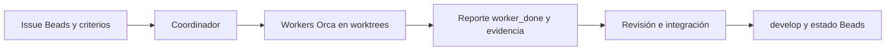

# Orquestación de Ondina con Orca

Esta sección es la entrada para pedir a Claude Code que prepare y supervise trabajo en Orca, con workers de Claude Code u OpenCode. Las áreas y cantidades son una propuesta; el usuario elegirá los modelos.

## Qué leer
1. [Configuración y arranque](configuracion.md): CLI, runtime, repositorio, worktrees y perfiles.
2. [Roles y cantidades](roles.md): propiedad, concurrencia y aceptación.
3. [Claude Code y OpenCode](claude-opencode.md): clientes, modelos y diferencias de ejecución.
4. [Plantilla de tarea](plantilla-tarea.md): spec verificable para cada Dispatch.
5. [Skills del proyecto](../skills.md): referencias disponibles y cuándo usarlas.

Las skills [orca-cli](../../.agents/skills/orca-cli/SKILL.md) y [orchestration](../../.agents/skills/orchestration/SKILL.md) son puntos de entrada al manual de la versión instalada. Cargar su guía desde el binario al iniciar una ejecución; no usar este documento como una copia exhaustiva de la API.

## Propuesta de equipo
Un coordinador, preferentemente Claude Code, conserva el alcance, reparte propiedad y valida la integración. El catálogo admite ocho slots de workers: dos frontend, dos backend, uno testing, uno documentación, uno CI/CD y uno seguridad.
El límite inicial recomendado es **tres workers simultáneos**, además del coordinador. Activar solo los roles necesarios; no mantener los ocho trabajando por defecto.
Para una tarea pequeña, un ejecutor y una revisión suelen bastar. Para un cambio funcional, frontend y backend pueden trabajar en una primera ola; testing/seguridad revisan después y documentación/CI cierran la entrega.

## Estado de preparación
La plantilla [perfiles.example.json](perfiles.example.json) no tiene modelos seleccionados y la ejecución está deshabilitada. Es una plantilla del proyecto para que el coordinador componga comandos; no es un archivo de configuración nativo de Orca.
Las consultas del 12-10-2026 resolvieron orca-ide, su guía y sus flags; Claude Code 2.1.296 y OpenCode 1.18.35 están instalados. El runtime de Orca figuraba desconectado y la aplicación detenida; no se inició una flota.
Configurar y probar la ejecución cuando el usuario elija perfiles y pida iniciar el trabajo.

## Seguimiento y propiedad
Beads conserva tareas, dependencias, aceptación y enlaces GitHub. Los Run/Task/Dispatch de Orca conservan los intentos de ejecución; incluir el ID de Beads en cada spec.
Un único worker escribe cada ruta o archivo compartido. Cada worker de implementación utiliza un worktree propio nacido de origin/develop; los cambios a contratos, migraciones o archivos compartidos se coordinan antes de editar.
El coordinador recibe reportes con evidencia, resuelve integración y publica dentro del alcance autorizado. Un heartbeat, un terminal vivo o un envío aceptado no prueban éxito.

## Pedido reutilizable para Claude Code
> Lee docs/orquestacion/README.md y las skills orca-cli y orchestration. Carga las guías del binario Orca que corresponda a este entorno. Revisa mis perfiles locales, el issue de Beads y sus dependencias. Propón la ola de trabajo con propiedad de archivos, modelos efectivos y un máximo de tres workers. Cuando esté autorizado iniciar, prepara el runtime y worktrees desde origin/develop, ejecuta con los clientes elegidos, valida cada resultado y liquida sus Dispatches.

## Ciclo de una tarea

Ver [herramientas](../herramientas-agentes.md) para las conexiones que deben configurarse por separado.
